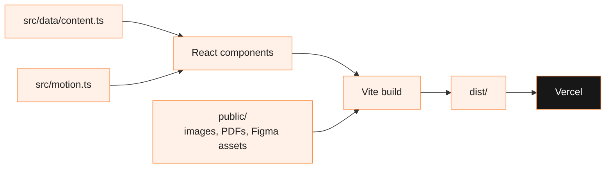

<div align="center">


<a href="https://mukesh.chillflareinnovations.com"></a>

<br/>

[](https://mukesh.chillflareinnovations.com)
[](package.json)
[](vite.config.ts)
[](tsconfig.json)
[](src/motion.ts)
<br/>
[](#-status)
[-blue)](LICENSE)

</div>

---

##  Overview

My personal portfolio, live at **[mukesh.chillflareinnovations.com](https://mukesh.chillflareinnovations.com)** (also [mukeshkumar-portfolio.vercel.app](https://mukeshkumar-portfolio.vercel.app)), as the founder page under Chillflare Innovations. The layout and motion follow JCREA's "Product Designer Portfolio" Figma Community template; the content comes from my 2026-27 resume.

| Section | Content |
|---|---|
| Hero | Name, role, SIH 2025 badge, photo on an animated semicircle |
| What I Do | AI/ML, LLMs & Agents, Embedded & IoT, Full-Stack & Cloud |
| Experience | Chillflare Innovations (Founder), IQMaths (SWE Intern), St. Joseph's College of Engineering |
| Why Hire Me | Summary with animated counters (Amazon ML Challenge rank, SIH win) |
| Projects | Filterable project cards with a detail panel and GitHub links for public repos |
| Achievements | Auto-scrolling strip of hackathon results |
| Contact | Email form (opens your mail client) |
| Certifications | Meta Front-End Developer professional certificate as a folder of its 9 courses, plus Infosys Springboard certificates; each opens in a pop-up viewer (pdf.js, loaded on demand) |

##  Animations

The Figma prototype's easing curves are ported to Framer Motion in [`src/motion.ts`](src/motion.ts):

| Figma | Used for |
|---|---|
| Ease-in-and-out back `[0.68,-0.6,0.32,1.6]` | Hover morphs (service cards, buttons) |
| Ease-out back `[0.34,1.56,0.64,1]` | Click morphs |
| Gentle spring (100 / 15) | Shared-layout pills: nav, hero CTA, project filters |
| Quick spring (300 / 20) | Small icon motion |

Sections reveal on scroll, the timeline draws itself, the achievements strip loops and pauses on hover, and everything respects `prefers-reduced-motion`.

##  How It Works



##  Run Locally

```bash
git clone https://github.com/mukesh-dev-git/portfolio-mukeshkumar.git
cd portfolio-mukeshkumar
npm install
npm run dev
```

`npm run build` type-checks and writes `dist/`. To change text, links or projects, edit [`src/data/content.ts`](src/data/content.ts) and push; Vercel redeploys from `main` and builds a preview for every other branch.

##  Project Structure

```
portfolio-mukeshkumar/
├── index.html
├── src/
│   ├── App.tsx
│   ├── motion.ts          # easing and variants from the Figma prototype
│   ├── styles.css         # design tokens and section styles
│   ├── data/content.ts    # all copy, projects, achievements, certificates
│   └── components/        # Navbar, Hero, Services, Experience, WhyMe, Projects, ...
├── public/
│   ├── myself.png
│   ├── assets/figma/      # template shapes, textures and icons
│   ├── carosal/           # achievement photos
│   ├── hackathon/         # hackathon certificates and photos
│   ├── coursera/          # course certificates (PDF)
│   └── springboard/       # Infosys Springboard certificates (PDF)
└── vercel.json
```

##  Status

Live. Rebuilt in October 2026 from a single CDN-React page to React + Vite with the new design. The previous version is in the git history.

Next updates:
- Swap in a cut-out photo to match the template's hero
- Add photos for the Amazon ML, HAC'KP and YESummit achievement cards

##  License

The code is MIT, see [LICENSE](LICENSE). My photos, certificates and personal content are not covered by that license; certificates belong to their issuers. The visual design is based on JCREA's portfolio template from the Figma Community.

<div align="center">


</div>
