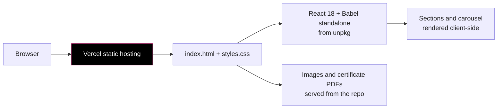

<div align="center">


<a href="https://mukeshkumar-portfolio.vercel.app"></a>

<br/>

[](https://mukeshkumar-portfolio.vercel.app)
[](index.html)
[](styles.css)
[](index.html)
<br/>
[](#-status)
[-blue)](LICENSE)

</div>

---

##  Overview

My personal portfolio, live at **[mukeshkumar-portfolio.vercel.app](https://mukeshkumar-portfolio.vercel.app)**. It is one static page with no build step: `index.html` loads React 18 and Babel from unpkg and renders the sections in the browser.

| Section | Content |
|---|---|
| About | Introduction and photo (`myself.png`) |
| Skills & Expertise | Technology groups |
| Experience | Co-Founder & Lead Software Developer at Powerenv Technologies (smart meters, March 2024 onward) |
| Achievements | Auto-sliding carousel of hackathon results (`carosal/`), with certificates and photos in `hackathon/` |
| Projects | Selected projects with short descriptions (no links yet) |
| Certifications & Courses | Coursera and Infosys Springboard certificates (`coursera/`, `springboard/` PDFs) |
| Contact | "Thank You" section with GitHub and LinkedIn links |

##  How It Works



##  Run Locally

No install needed; serve the folder with any static server:

```bash
git clone https://github.com/mukesh-dev-git/portfolio-mukeshkumar.git
cd portfolio-mukeshkumar
npx serve .
```

To update the site, edit `index.html` / `styles.css`, add images or PDFs to the matching folder, and push; Vercel redeploys from `main`.

##  Project Structure

```
portfolio-mukeshkumar/
├── index.html      # all sections as React components (type="text/babel")
├── styles.css
├── script.js       # placeholder, logic lives in index.html
├── myself.png
├── carosal/        # carousel images for the achievements slider
├── hackathon/      # hackathon certificates and photos
├── coursera/       # course certificates (PDF)
└── springboard/    # Infosys Springboard certificates (PDF)
```

##  Status

Live and online. The content was last updated on 11 January 2026, so achievements and projects from later in 2026 are not on the page yet.

Notes for the next update:
- Babel compiles the JSX in the browser on every visit; a small Vite build would load faster
- Several images in `carosal/` are over 1 MB; compressing them (WebP) would speed up the first load
- The folder is spelled `carosal/`; renaming it means updating the paths in `index.html`

##  License

The code (`index.html`, `styles.css`, `script.js`) is MIT, see [LICENSE](LICENSE). My photos, certificates and personal content are not covered by that license; certificates belong to their issuers.

<div align="center">


</div>
